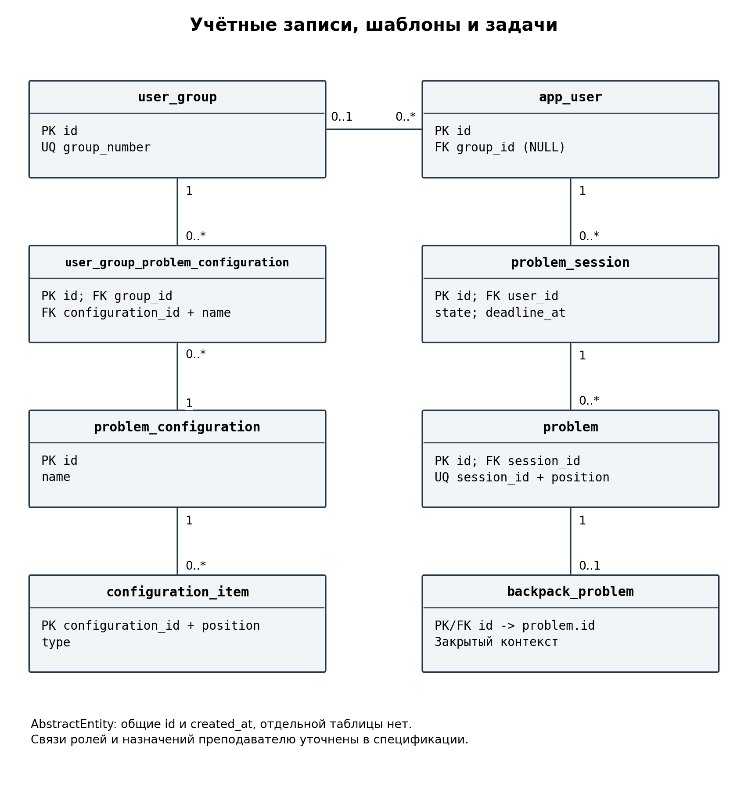
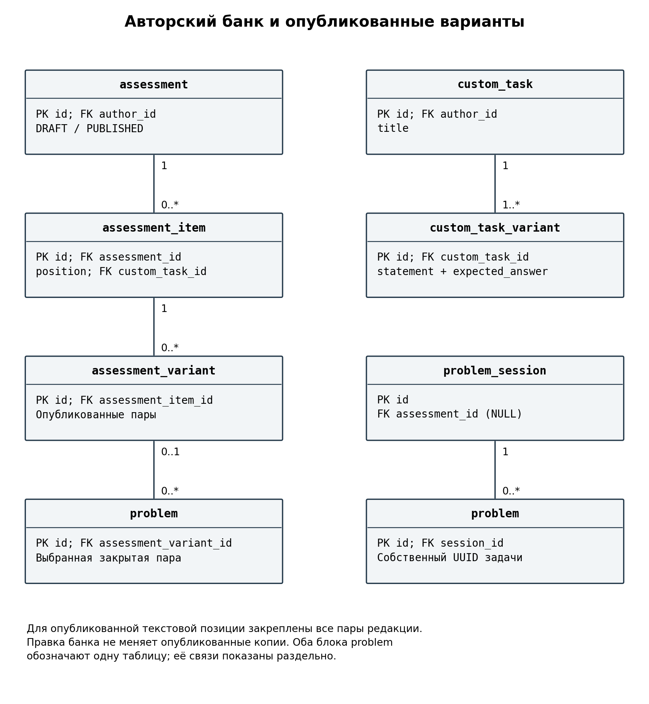
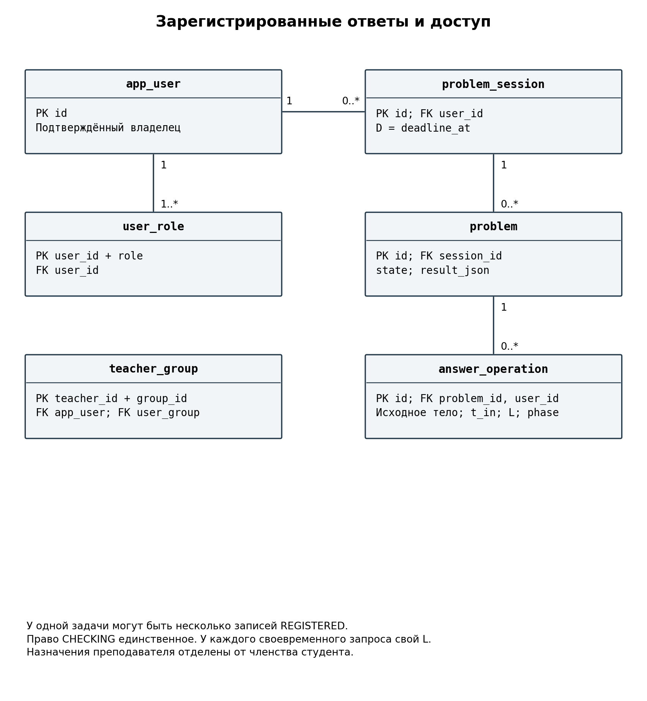

# Приложение Б. Физическая модель данных

Редакция 1.0 от 25.11.2026. Автор — Самбьюи А.Ж. Статус — проект физической модели для рассмотрения в составе DOC-06; принятие и реализация не подтверждены. Основание — задача 3.9, логическая модель приложения А, [SWR-CFG](Конфигурации_и_модерация.md), [SWR-SES](DOC-06.2_Сессии_задач_и_планировщик.md) и [DOC-08](../09_Архитектура_и_API/DOC-08_Справочник_API.md).

## Область модели и обозначения

Модель задаёт таблицы PostgreSQL 17 и сохраняемые связи целевой системы. Имена таблиц и внутренних полей — проектные решения данной редакции; они не меняют имена полей API. Первоначальные восемь типов сопоставлены с физическим хранением ниже. Контрольные мероприятия, варианты и принятые ответы расширяют этот перечень согласно действующим требованиям. Число типов в исходном перечне не ограничивает число таблиц.

`PK` — первичный ключ, `FK` — внешний ключ, `UQ` — уникальность. В столбце «NULL» значение «да» разрешает отсутствие значения; «нет» требует значение. Для таблиц-сущностей общий каркас задаёт `id uuid PK NOT NULL` и `created_at timestamptz NOT NULL`, назначаемые сервером. Исключения — таблицы связей и позиций с явно указанным составным ключом. `AbstractEntity` описывает этот каркас и отдельной таблицы не требует.

Все временные сравнения выполняются по серверным моментам. Тип `timestamptz` представляет момент времени; наружу он преобразуется в формат UTC действующего API. Для внутреннего времени принятых ответов не вводится округление до целых секунд. Значения секретов подключения и подписи JWT в эти таблицы не включаются.

## ER-диаграммы

Прямоугольник обозначает таблицу. `1` у конца связи означает ровно одну запись, `0..*` — ноль или больше, `0..1` — необязательную единственную запись. Связи читаются совместно с FK и ограничениями спецификации; на диаграммах показаны основные связи, повторные ссылки пользователя вынесены в таблицы.

{width=100%}

{width=100%}

{width=100%}

Редактируемые векторные изображения и [скрипт построения](../assets/model/build_er.py) хранятся рядом с PNG. Для печати сборщик использует соответствующие PDF-изображения.

## Соответствие первоначальному перечню

| Тип | Физическое представление |
|---|---|
| `AbstractEntity` | Общие `id` и `created_at`; отдельной таблицы нет |
| `User` | `app_user`, роли — `user_role`, назначения преподавателю — `teacher_group` |
| `UserGroup` | `user_group` |
| `UserGroupProblemConfiguration` | `user_group_problem_configuration` |
| `ProblemConfiguration` | `problem_configuration` и упорядоченные `configuration_item` |
| `ProblemSession` | `problem_session` |
| `Problem` | `problem`; отдельные запросы — `answer_operation` |
| `BackpackProblem` | `backpack_problem`, расширение задачи с тем же UUID |

## Учётные записи и учебные группы

### Таблица user_group

Помимо общего каркаса сохраняются следующие поля.

| Поле | Тип | NULL | Значение и ограничения |
|---|---|---|---|
| `name` | `text` | нет | Отображаемое название |
| `group_number` | `text` | нет | Учебный номер, UQ; используется при сопоставлении доверенного профиля |

### Таблица app_user

| Поле | Тип | NULL | Значение и ограничения |
|---|---|---|---|
| `email` | `text` | да | Уникальное ненулевое значение; обязательно для локальной регистрации |
| `name` | `text` | нет | Имя пользователя |
| `password_hash` | `text` | да | Хеш локального пароля; исходный пароль не сохраняется |
| `mephi_subject` | `text` | да | Устойчивый идентификатор подтверждённой внешней личности; UQ среди ненулевых |
| `group_id` | `uuid` | да | FK на `user_group.id`; только подтверждённая группа студента |

Локальный способ входа требует электронной почты и хеша; внешний — подтверждённого `mephi_subject`. Привязка сохраняет UUID существующего пользователя. Конкурирующие подтверждения одной внешней личности не создают двух владельцев. Порядок подтверждения определяется [SWR-AUTH](Программные_требования_платформы.md#учётная-запись-и-доступ); таблица не делает введённый клиентом номер группы доверенным.

### Таблицы user_role и teacher_group

| Таблица и поле | Тип | NULL | Ключи и назначение |
|---|---|---|---|
| `user_role.user_id` | `uuid` | нет | FK на `app_user.id` |
| `user_role.role` | `text` | нет | `USER`, `TEACHER` или `ADMIN`; PK пары `(user_id, role)` |
| `teacher_group.teacher_id` | `uuid` | нет | FK на `app_user.id`; при назначении проверяется роль `TEACHER` |
| `teacher_group.group_id` | `uuid` | нет | FK на `user_group.id`; PK пары `(teacher_id, group_id)` |

Эти две таблицы не используют общий каркас. `teacher_group` хранит действующие назначения, отдельно от членства студента и авторства работ. Отзыв удаляет назначение, сохраняя мероприятия, сессии и результаты. Каждое чтение ведомости и публикация проверяют действующее назначение до выдачи данных.

## Шаблоны самостоятельной практики

### Таблица problem_configuration

| Поле | Тип | NULL | Значение и ограничения |
|---|---|---|---|
| `name` | `text` | нет | Имя для каталога и параметра `configuration`; UQ пары `(id, name)` для составного FK |

Глобальная уникальность имени не задаётся: одинаковые имена в разных группах допустимы.

### Таблица user_group_problem_configuration

| Поле | Тип | NULL | Значение и ограничения |
|---|---|---|---|
| `group_id` | `uuid` | нет | FK на `user_group.id` |
| `configuration_id` | `uuid` | нет | Ссылка на шаблон |
| `configuration_name` | `text` | нет | Физическая копия его имени для групповой уникальности |
| `enabled` | `boolean` | нет | Доступность нового старта именно этой группе |

UQ `(group_id, configuration_id)` исключает противоречивые назначения. UQ `(group_id, configuration_name)` обеспечивает однозначный выбор по имени в группе. Составной FK `(configuration_id, configuration_name)` ссылается на `(id, name)` шаблона: это не независимый псевдоним. При изменении имени его копии обновляются согласованно; конфликт групповой уникальности отклоняет всё изменение. Отключённое назначение остаётся видимым в каталоге.

### Таблица configuration_item

| Поле | Тип | NULL | Значение и ограничения |
|---|---|---|---|
| `configuration_id` | `uuid` | нет | FK на `problem_configuration.id` |
| `position` | `integer` | нет | Положительный номер позиции, PK `(configuration_id, position)` |
| `type` | `text` | нет | Устойчивый код подключённого модуля |

Таблица позиций не использует общий каркас. Уникальность по типу не устанавливается: одинаковые коды могут занимать разные позиции. Порядок определяется `position`, а не порядком строк результата SQL. Изменение шаблона не изменяет уже выданные задачи.

## Авторский банк и публикация

### Таблица custom_task

| Поле | Тип | NULL | Значение и ограничения |
|---|---|---|---|
| `author_id` | `uuid` | нет | FK на `app_user.id`; владелец банка |
| `title` | `text` | нет | Название упражнения |

### Таблица custom_task_variant

| Поле | Тип | NULL | Значение и ограничения |
|---|---|---|---|
| `custom_task_id` | `uuid` | нет | FK на `custom_task.id` |
| `position` | `integer` | нет | Положительный номер, UQ `(custom_task_id, position)` |
| `statement` | `text` | нет | Заполненное условие преподавателя |
| `expected_answer` | `text` | нет | Заполненный закрытый эталон; не публичное поле задачи |

Запись задания вместе с одним или больше полными вариантами сохраняется согласованно. Полная замена банка может заменять его дочерние варианты; опубликованные копии от них не зависят.

### Таблица assessment

| Поле | Тип | NULL | Значение и ограничения |
|---|---|---|---|
| `author_id` | `uuid` | нет | FK на `app_user.id` |
| `title` | `text` | нет | Название работы |
| `state` | `text` | нет | Только `DRAFT` или `PUBLISHED` |
| `repeat_allowed` | `boolean` | да | В черновике `null` означает отложенный выбор |
| `group_id` | `uuid` | да | FK на `user_group.id`; обязательно при публикации |
| `opens_at`, `closes_at` | `timestamptz` | да | Обе границы обязательны для `PUBLISHED`, `opens_at < closes_at` |

UUID общего `id` передаётся как `assessmentId`. Проверка строки состояния требует для `PUBLISHED` группу, обе границы и ненулевой `repeat_allowed`. Непустой состав и полномочия автора проверяются в той же транзакции публикации; межтабличные проверки не выдаются за простой `CHECK` одной строки.

### Таблица assessment_item

| Поле | Тип | NULL | Значение и ограничения |
|---|---|---|---|
| `assessment_id` | `uuid` | нет | FK на `assessment.id` |
| `position` | `integer` | нет | Положительный номер, UQ `(assessment_id, position)` |
| `type` | `text` | нет | Код подключённого модуля; повтор кода допустим |
| `custom_task_id` | `uuid` | да | FK на `custom_task.id`; обязателен для `CUSTOM_TEXT` |
| `settings_json` | `text` | да | JSON настроек модуля, если они предусмотрены его контрактом |

Редактируется состав только черновика. Для текстовой позиции проверяется принадлежность упражнения автору мероприятия. После публикации позиции этой работы неизменяемы.

### Таблица assessment_variant

| Поле | Тип | NULL | Значение и ограничения |
|---|---|---|---|
| `assessment_item_id` | `uuid` | нет | FK на `assessment_item.id` |
| `position` | `integer` | нет | Номер пары в опубликованной редакции, UQ внутри позиции |
| `statement` | `text` | нет | Копия условия на момент публикации |
| `expected_answer` | `text` | нет | Копия закрытого эталона той же пары |

В транзакции публикации копируются все пары выбранной редакции каждого включённого текстового задания. FK на изменяемый вариант банка не заменяет копию. Одновременная правка банка не смешивает условие одной редакции с эталоном другой. Опубликованные пары не редактируются и не удаляются вслед за заменой банка. Конкретная пара выбирается при старте личной сессии.

## Личные сессии и задачи

### Таблица problem_session

| Поле | Тип | NULL | Значение и ограничения |
|---|---|---|---|
| `user_id` | `uuid` | нет | FK на `app_user.id`; владелец |
| `assessment_id` | `uuid` | да | FK на `assessment.id`; `null` для практики |
| `configuration_id` | `uuid` | да | FK на `problem_configuration.id`; источник практики |
| `deadline_at` | `timestamptz` | нет | Для контроля минимум из `created_at + 20 минут` и `closes_at` |
| `state` | `text` | нет | `NEW`, `SOLVED` или `FAILED` |

Ровно один источник набора задан ненулевым. Допуск и запись выполняются под блокировкой пользователя по [SWR-SES-003](DOC-06.2_Сессии_задач_и_планировщик.md#swr-ses-003). Частичный UQ по `user_id` для сохранённых строк `state = NEW` служит дополнительной защитой. До нового старта под той же блокировкой учитываются просрочка и своевременные ответы прежнего набора; индекс не вычисляет течение времени сам. Пара `(user_id, assessment_id)` не уникальна: разрешённый повтор создаёт новый UUID. Неполный набор не фиксируется по [SWR-SES-005](DOC-06.2_Сессии_задач_и_планировщик.md#swr-ses-005).

### Таблица problem

| Поле | Тип | NULL | Значение и ограничения |
|---|---|---|---|
| `session_id` | `uuid` | нет | FK на `problem_session.id` |
| `position` | `integer` | нет | Положительный номер, UQ `(session_id, position)` |
| `type` | `text` | нет | Сохранённый тип выданной задачи |
| `statement_json` | `text` | нет | Текст сериализованного JSON условия; выдаётся строкой `statement` |
| `assessment_item_id` | `uuid` | да | FK на опубликованную позицию для контрольной задачи |
| `assessment_variant_id` | `uuid` | да | FK на выбранную опубликованную пару для `CUSTOM_TEXT` |
| `expected_answer` | `text` | да | Закреплённый закрытый эталон текстовой задачи |
| `private_context_json` | `text` | да | Закрытый JSON контекста предметного модуля |
| `state` | `text` | нет | `NEW`, `SOLVED` или `FAILED` |
| `result_json` | `jsonb` | да | Сохранённый предметный результат; при просрочке — SQL NULL |

При создании проверяется соответствие опубликованной позиции мероприятию сессии, а пары — этой позиции. Условие и закрытая часть копируются согласованно. Для `CUSTOM_TEXT` внутреннее JSON-значение условия — строка; внешний API возвращает текст её сериализации по [контракту](Контракты_сессий.md#пользовательское-текстовое-задание). Общий `type` не ограничивается тремя известными примерами: новые коды поступают из реестра модулей.

`SOLVED` требует сохранённый положительный вердикт. `FAILED` различает неверное решение с отрицательным `result_json` и просрочку с SQL NULL. Состояние сессии пересчитывается в той же транзакции, что вердикт и завершение операции. Публичное представление строится явно: `expected_answer` и `private_context_json` не сериализуются ни в один обзор или историю.

### Таблица backpack_problem

`id` одновременно PK и FK на `problem.id`; это необязательное расширение одной задачи. `created_at` относится к той же выдаче. Принадлежность и итог берутся из `problem` и `problem_session`, не дублируются независимым состоянием расширения.

| Поля | Тип | NULL | Назначение |
|---|---|---|---|
| `power` | `integer` | нет | Положительная размерность |
| `variant_type` | `text` | нет | Вариант ранца по DOC-06.3 |
| `message`, `decoded_message` | `text` | нет | Текстовая JSON-запись списков логических значений |
| `light_backpack`, `hard_backpack` | `text` | нет | Текстовая JSON-запись списков десятичных строк |
| `omega`, `reverse_omega`, `module`, `encoded_message` | `text` | нет | Целые произвольной длины в десятичной записи |

Сохраняется полный предметный контекст генерации; это не готовое публичное условие. Студенту открываются только величины, предусмотренные [DOC-06.3](DOC-06.3_Ранцевые_криптосистемы.md#6-хранение). Данные редакционных генераций в таблицу не записываются. Остальные модули сохраняют нужный закрытый контекст в `problem`; модель не вводит неподтверждённые отдельные таблицы каждого модуля.

## Зарегистрированные ответы

### Таблица answer_operation

| Поле | Тип | NULL | Значение и ограничения |
|---|---|---|---|
| `user_id` | `uuid` | нет | FK на `app_user.id`; подтверждённый отправитель |
| `problem_id` | `uuid` | нет | FK на `problem.id`; владение проверяется до регистрации |
| `request_body` | `bytea` | нет | Полное исходное тело, включая невалидный JSON |
| `content_type` | `text` | да | Сохранённый тип содержимого для повторного разбора |
| `received_at` | `timestamptz` | нет | Исходный `t_in`, не время начала вычисления |
| `processing_limit` | `timestamptz` | нет | Исходный `L = received_at + 60 секунд` |
| `phase` | `text` | нет | Внутренняя фаза `REGISTERED`, `CHECKING` или `CLOSED` |
| `closed_at` | `timestamptz` | да | Обязательно для `CLOSED`, иначе отсутствует |
| `outcome_code` | `text` | да | Причина завершения либо признак записи вердикта; не заменяет публичный контракт ошибки |

Общий UUID этой таблицы — UUID отдельного обращения. До очереди сохраняется запись `REGISTERED`; она ещё не подтверждает формат или право вычислять. Тип `bytea` выбран, чтобы сохранить исходные байты до JSON-проверки. Одна колонка `jsonb` для этой цели недостаточна: разбор неверного JSON должен завершаться предусмотренной ошибкой после регистрации.

У одной задачи могут быть несколько зарегистрированных ответов. UQ по всем открытым записям задачи не устанавливается. Единственность относится к праву предметной проверки: частичный UQ по `problem_id` при `phase = CHECKING` дополняет допуск под блокировками. Право получает только один прошедший допуск и проверку формата запрос. Проигравший допустимый запрос закрывается с `CHECK_IN_PROGRESS`, не меняя тела победителя. На возобновление одной операции исполнителю предоставляется исключительное владение; механизм исполнения не продлевает `processing_limit`.

Своевременная открытая регистрация подтверждённого владельца защищает задачу от просрочки ещё до вычисления, по [SWR-SES-015](DOC-06.2_Сессии_задач_и_планировщик.md#swr-ses-015). Для каждого запроса проверяются `received_at < deadline_at`, незавершённость и собственный `processing_limit`. Поздняя регистрация не создаёт защиты. Отказ одного запроса снимает только его защиту; остальные своевременные обращения учитываются отдельно. У неизвестной или чужой задачи операция не открывается.

При достижении `L` незавершённая операция закрывается без вердикта. Если `L < D`, задача остаётся `NEW` и новый ответ допустим до `D`. Если `D` уже достигнут и другой своевременной обработки нет, задача имеет `FAILED` без вердикта. При восстановлении исходные `received_at`, `processing_limit`, тело и фаза сохраняются. Повторная предметная проверка уже записанного вердикта не выполняется.

## Транзакции, индексы и сохранность

| Изменение | Совместно проверяемые и сохраняемые данные |
|---|---|
| Публикация | Роль, актуальное назначение группы, принадлежность работы, допустимые границы, непустой состав и явное правило повтора; затем все опубликованные пары, окно и `PUBLISHED` одной транзакцией |
| Создание набора | Блокировка пользователя, актуальное состояние прежней сессии и история повторов; новая сессия, все задачи, позиции и варианты фиксируются целиком |
| Регистрация ответа | Владелец и исходное время согласуются с контролем срока; полное тело сохраняется до очереди |
| Допуск вычисления | Проверяются срок, состояние и JSON-форма; единственное право `CHECKING` не заменяет остальные регистрации |
| Вердикт | Блокировки в порядке «сессия — задача — операция»; повторная проверка предела, результат, состояния задачи и набора, закрытие операции |
| Чтение | Права и актуальное представление просрочки с учётом всех своевременных обработок; сохранённый вердикт имеет приоритет |

Помимо PK и UQ предусматриваются индексы на внешних ключах, историю `(user_id, assessment_id, created_at)` сессий, выборку мероприятий по группе и выборку незавершённых операций по фазе и пределу. Это решения доступа к данным, а не подтверждение показателей p95. Проверки межтабличного состава и полномочий выполняются транзакционно; они не подменяются ограничением одной колонки.

Для связей исторических сессий, опубликованных позиций, выданных задач и результатов применяется запрет удаления родителя, пока на него ссылается история. Каскадное удаление пользователя или группы не должно уничтожать прохождения. Для изменяемых дочерних строк банка и черновика допустима согласованная замена в пределах уже заданных операций. Новая пользовательская операция удаления или срок хранения этой моделью не вводятся.

## Таблицы и операции API

| Операция | Читаемые или изменяемые таблицы |
|---|---|
| Регистрация, вход, привязка МИФИ | `app_user`, `user_role`, `user_group`; создание внешнего подтверждения остаётся обязанностью AUTH |
| Назначение преподавателю групп | `teacher_group`; проверяются пользователь, роль и существование группы |
| Каталог групповых шаблонов | Связка назначения, `problem_configuration`, `configuration_item`; `enabled` читается для запрошенной группы |
| Создание и замена `/api/custom-tasks` | `custom_task` и полная замена `custom_task_variant`; опубликованные копии сохраняются |
| Создание и замена `/api/assessments` | `assessment`, `assessment_item`; изменения разрешены только для собственного `DRAFT` |
| Публикация `/publish` | `assessment`, позиции, `assessment_variant`, действующие `teacher_group` и банк; согласованное закрепление всех пар |
| Расписание `/api/users/me/schedule` | Опубликованные `assessment`, группа владельца, его `problem_session`, задачи и открытые операции для определения доступности |
| Старт `/api/tasks/session` | Источник состава; `problem_session`, `problem`, расширение ранца; варианты для текстовых позиций |
| Решение `/api/tasks/submit` | `answer_operation`, сохранённая задача и контекст; при вердикте обновляются задача, сессия и операция |
| Чтение сессии, история, `/results`, модерация | Сессии, задачи и операции; для ведомости — авторство и действующее назначение группы. Эталоны и исходные тела ответов не включаются |

## Контроль модели и технические источники

Сверка документации охватывает: две одноимённые конфигурации разных групп; повторяющиеся позиции; пустой черновик; публикацию и правку банка одновременно; повторные прохождения; два старта одного пользователя; несколько своевременных регистраций ответа; неверный JSON; границы `D` и `L`; перезапуск до и после фиксации. Критерий — отсутствие противоречий с исходными SR/SWR и описательными кейсами DOC-10. Это не результат выполнения SQL или программных испытаний.

Технические свойства типов и ограничений сверены по документации PostgreSQL 17: [даты и время](https://www.postgresql.org/docs/17/datatype-datetime.html), [ограничения](https://www.postgresql.org/docs/17/ddl-constraints.html), [частичные индексы](https://www.postgresql.org/docs/17/indexes-partial.html), [двоичные данные](https://www.postgresql.org/docs/17/datatype-binary.html). Выбор конкретных таблиц, имён и границ записи относится к проекту.

История: 25.11.2026 — подготовлены проект физической модели, ER-диаграммы, поля, типы, ограничения и соответствие операциям API для задачи 3.9.
